# MakerConnect 

> **Universidade Católica de Santa Catarina — Jaraguá do Sul**
>  
> Curso: Engenharia de Software | Fase:8ª
> 
> Professor orientador: Rodrigo Otavio Ribeiro Hagstrom
>
> Acadêmico: Vinicius Froes
>
>  Projeto de Aprendizagem Colaborativa — PAC Extensionista e TCC

---

## 1. Introdução

Muito se discute a importância da documentação técnica como base para a reprodutibilidade e o reuso de projetos tecnológicos. No universo Maker e da Internet das Coisas (IoT), no entanto, essa prática ainda é negligenciada: projetos inovadores se perdem pela ausência de registros estruturados, gerando o que se pode chamar de "documentação fantasma". Plataformas como GitHub e Instructables permitem o compartilhamento de projetos, mas não automatizam nem orientam ativamente a produção documental.

Ao observar o cenário das comunidades Maker, percebe-se que documentar um protótipo de forma completa exige tempo e esforço que muitos desenvolvedores não têm disponíveis. Segundo pesquisa realizada por Dong et al. (2025), abordagens baseadas em Retrieval-Augmented Generation (RAG) demonstram resultados promissores na extração e organização de conhecimento técnico a partir de descrições não estruturadas, reduzindo erros comuns em sistemas de IA sem ancoragem em dados reais. Diante disso, surge a pergunta central deste projeto: **como agentes de IA Generativa, orquestrados via processamento assíncrono, podem reduzir a lacuna documental em projetos Maker IoT, promovendo reprodutibilidade e rastreabilidade?**

A MakerConnect responde a essa questão integrando três pilares: uma camada social com feed, fork e log de dificuldades; um pipeline de IA com RAG; e uma camada documental com exportação em PDF auditável. Para os makers beneficiados, a plataforma democratiza boas práticas de engenharia, permitindo gerar documentação padronizada e reutilizável independentemente do nível de experiência. Para os acadêmicos envolvidos, o projeto mobiliza competências centrais do curso — desenvolvimento full-stack, arquitetura de sistemas, IA aplicada e conformidade com a LGPD — conectando formação teórica a um problema real com impacto mensurável.

### 1.1 Do DIY à cultura Maker: contexto histórico

Construir, consertar e adaptar os próprios objetos é um hábito muito anterior à palavra "maker". Atkinson (2006) mostra que o *do it yourself* (DIY) se consolidou ao longo do século XX como uma forma de democratização do design, em que pessoas comuns assumiam tarefas antes restritas a profissionais. Durante a Segunda Guerra Mundial, o governo britânico distribuiu o folheto *Make Do and Mend* (1943), que ensinava a consertar e reaproveitar roupas em tempos de racionamento: o reparo como necessidade, não como passatempo. No pós-guerra, o radioamadorismo e os kits eletrônicos para montar em casa, como os da Heathkit, levaram o DIY para a eletrônica.

Nos anos 1960 e 1970 esse espírito ganhou uma face tecnológica e contracultural. O *Whole Earth Catalog* (1968), de Stewart Brand, trazia o lema *Access to Tools* ("acesso a ferramentas") e, segundo Turner (2006), ajudou a ligar a contracultura californiana à cultura computacional que viria depois. Em janeiro de 1975, o computador Altair 8800 estampou a capa da *Popular Electronics*; dois meses depois surgiu o Homebrew Computer Club, em Menlo Park, onde entusiastas trocavam esquemas e código livremente, e onde Steve Wozniak apresentaria o Apple I. Levy (1984) resumiu a ética desse grupo em princípios como:

> "O acesso a computadores — e a qualquer coisa que possa te ensinar algo sobre como o mundo funciona — deve ser ilimitado e total. Sempre ceda ao Imperativo da Mão na Massa!" (LEVY, 1984, tradução nossa)

Na educação, Papert (1980) formulou o construcionismo: aprende-se melhor construindo artefatos concretos e compartilháveis. A ideia reaparece em Blikstein (2013), que defende a fabricação digital nas escolas como uma "democratização da invenção".

A virada para o que hoje se chama movimento Maker aconteceu nos anos 2000, quando ferramentas antes industriais ficaram baratas. No MIT, Neil Gershenfeld criou a disciplina *How to Make (Almost) Anything* e os primeiros Fab Labs, laboratórios de fabricação digital abertos à comunidade (GERSHENFELD, 2005). O ano de 2005 concentrou marcos decisivos: Dale Dougherty lançou a revista *Make:* e, com ela, o termo "maker" para reunir eletrônica, marcenaria, costura e programação sob um mesmo rótulo; em Ivrea, na Itália, nasceu o Arduino, placa de hardware aberto pensada para quem não é engenheiro (BANZI, 2008); na Universidade de Bath, Adrian Bowyer iniciou o RepRap, uma impressora 3D capaz de fabricar boa parte das próprias peças (JONES et al., 2011); e o Instructables começou a reunir tutoriais passo a passo. Seguiram-se a primeira Maker Faire (2006), o Thingiverse (2008), a expiração em 2009 da patente da modelagem por deposição fundida (FDM, US 5.121.329), que barateou a impressão 3D, e o Raspberry Pi (2012). Dougherty e Conrad (2016) narram como a revista e as feiras transformaram hobbistas isolados em uma comunidade. Anderson (2012) descreveu o fenômeno como uma "nova revolução industrial" e, em 2014, Hatch (2014) publicou o *Maker Movement Manifesto*, organizado em nove verbos: *make, share, give, learn, tool up, play, participate, support, change*. No mesmo ano, a Casa Branca realizou a sua própria Maker Faire.

No Brasil, a cultura do improviso — a "gambiarra" — sempre esteve presente, e o movimento ganhou estrutura com fab labs universitários e públicos, como a rede Fab Lab Livre SP, inaugurada pela Prefeitura de São Paulo em 2015, e com a chegada da fabricação digital a escolas e cursos técnicos.

Dos nove verbos de Hatch, *share* (compartilhar) é o que mais depende de documentação, e é aí que a cultura Maker ainda falha: o protótipo funciona na bancada, mas o caminho até ele (peças, ligações, erros e soluções) raramente fica registrado. A MakerConnect se coloca nessa tradição: em vez de exigir que o maker vire redator técnico, usa IA para transformar o que ele já produz (descrição, BOM, fotos, log de dificuldades) em documentação reproduzível. Uma versão resumida desta história, com linha do tempo e imagens de licença livre, aparece na seção "Nossa história" da página inicial (`maker-connect/components/maker-history.tsx`).

---

## 2. Público Beneficiado

O público beneficiado pelo projeto MakerConnect é composto por makers e entusiastas de IoT independentes — pessoas que desenvolvem projetos tecnológicos por iniciativa própria, fora de ambientes corporativos formais, motivadas pela experimentação, aprendizado e compartilhamento de conhecimento. Esse perfil abrange desde estudantes de cursos técnicos e de graduação que desenvolvem protótipos como parte de sua formação, até profissionais e autodidatas que atuam em projetos pessoais ou colaborativos envolvendo eletrônica, automação e conectividade.

Por se tratar de uma plataforma digital, o alcance do projeto não se limita a um único espaço físico. O público será beneficiado em múltiplos contextos: na Católica de Santa Catarina, instituição de origem do projeto, onde estudantes poderão utilizar a plataforma em atividades acadêmicas e de extensão; em espaços makers, fablabs e laboratórios de inovação da região de Joinville e do estado de Santa Catarina; e de forma ampliada por meio do acesso online, alcançando comunidades maker distribuídas pelo Brasil. Essa abrangência reforça o caráter extensionista do projeto, que ultrapassa os muros da universidade para gerar impacto em uma comunidade técnica ativa e crescente.

---

## 3. Objetivos

### 3.1 Objetivo Geral

Desenvolver a MakerConnect, uma plataforma digital de governança técnica para projetos Maker e IoT, integrando mecanismos de colaboração social, pipeline de Inteligência Artificial Generativa com Retrieval-Augmented Generation (RAG) orquestrado via fila assíncrona (BullMQ) e exportação automatizada de documentação técnica em PDF, com o propósito de reduzir a lacuna documental em comunidades makers, promovendo reprodutibilidade, rastreabilidade e reuso de conhecimento técnico em conformidade com a LGPD.

### 3.2 Objetivos Específicos

1. Implementar o pipeline funcional de Inteligência Artificial com estágios de extração, pré-processamento, geração via RAG e exportação de documentação técnica em PDF, garantindo rastreabilidade e conformidade com a LGPD por meio da anonimização de dados pessoais antes do processamento.

2. Construir a camada social da plataforma com funcionalidades de feed, fork com linhagem, upvote e log de dificuldades técnicas, permitindo que makers registrem, compartilhem e reutilizem projetos IoT de forma colaborativa e auditável.

3. Validar o desempenho do pipeline de IA por meio de métricas objetivas de relevância e latência, utilizando um conjunto de projetos IoT reais como base de avaliação, com meta mínima de 85% de relevância na recuperação semântica e tempo de resposta dentro de parâmetros operacionais aceitáveis.

---

## 4. Atividades Realizadas

A implementação do pipeline de Inteligência Artificial constituiu o núcleo tecnológico da MakerConnect, sendo estruturada em quatro estágios sequenciais e interdependentes. O primeiro estágio, de extração, é responsável por receber a descrição textual do projeto maker, sanitizar dados pessoais identificáveis (PII) por meio de expressões regulares para e-mail, telefone e CPF, e extrair palavras-chave por frequência com remoção de stopwords. Esse processo garante que nenhuma informação pessoal trafegue pelo pipeline de IA, assegurando conformidade com a LGPD antes mesmo do disparo para o orquestrador.

O segundo estágio foi originalmente orquestrado pelo workflow n8n, escolhido pela flexibilidade e integração via webhooks. Ao longo do projeto, esse estágio migrou para uma fila assíncrona própria (BullMQ + Redis), que hoje é o motor padrão em produção — o worker chama o Ollama e o Pinecone diretamente, sem o n8n como intermediário; o workflow n8n permanece no código como motor legado, disponível via variável de ambiente. Independentemente do motor, a geração de embeddings usa o modelo nomic-embed-text via Ollama, convertendo o conteúdo textual em vetores semânticos e recuperando contexto técnico relevante no banco vetorial Pinecone. Essa abordagem de Retrieval-Augmented Generation (RAG) ancora a geração de conteúdo em dados reais de componentes eletrônicos, eliminando alucinações técnicas que comprometeriam a confiabilidade da documentação gerada.

O terceiro estágio consiste na geração estruturada pelo modelo de linguagem qwen2.5:7b-instruct, que recebe o contexto recuperado e produz saídas organizadas contendo requisitos de software e hardware, lista de materiais (BOM), etapas de montagem e recomendações técnicas. O resultado é persistido na API da MakerConnect com status, latência em milissegundos e conteúdo gerado no log de extração do projeto. Todo o ciclo opera de forma assíncrona, com estados rastreáveis: `queued`, `processing`, `done` e `failed`. Um microsserviço complementar em Python (Fase 5, `ml-pipeline/`) classifica categoria/dificuldade/domínio do projeto antes da geração — filtrando a busca vetorial por domínio — e audita a saída gerada depois, sinalizando peças possivelmente esquecidas na BOM.

O quarto e último estágio é a exportação documental em PDF. Após a conclusão da extração, o dono do projeto pode revisar e editar livremente o resultado no Dossiê Técnico (requisitos, BOM, etapas de montagem, vídeo e imagens) sem alterar a saída original da IA, preservada para auditoria. A exportação em si é montada de forma assíncrona a partir desse dossiê, utilizando a biblioteca jsPDF, com logo, link do projeto e conteúdo organizado por tópicos, e armazenada no MinIO, serviço de object storage compatível com S3. O histórico de exportações fica registrado na base de dados transacional MySQL, permitindo auditoria técnica por versão de documento. Para acompanhamento operacional do pipeline, foi implementado um endpoint de métricas que expõe indicadores de desempenho como p50 e p95 de latência, média de relevância RAG e total de execuções, acessíveis por meio de um painel administrativo na própria plataforma.

A camada social da MakerConnect foi desenvolvida com o objetivo de criar um ambiente colaborativo onde makers pudessem não apenas compartilhar projetos, mas também construir sobre o trabalho uns dos outros de forma rastreável e auditável. O feed principal da plataforma oferece filtros por categoria, busca textual, paginação e ordenação por mais recentes, mais antigos e mais votados, permitindo que o usuário navegue pelo acervo de projetos de forma eficiente e personalizada.

Um dos mecanismos centrais da camada social é o **fork com linhagem**. Ao realizar um fork de um projeto existente, o novo projeto herda um campo `parentId` que aponta para sua origem, formando uma árvore de reuso técnico auditável. Esse mecanismo, inspirado em práticas de versionamento de código, permite que a comunidade identifique a origem e a evolução de cada projeto, promovendo transparência e reconhecimento da autoria original. Complementarmente, o sistema de upvote idempotente garante que cada usuário registre apenas um voto por projeto, utilizando chave única composta no banco de dados para evitar duplicidades e manter a integridade da métrica social.

O log de dificuldades técnicas representa outro diferencial da plataforma. Por meio desse recurso, o maker pode registrar os obstáculos encontrados durante o desenvolvimento do projeto — como problemas de compatibilidade de componentes, falhas de firmware ou limitações de protocolo —, criando uma memória técnica associada a cada projeto. Essa informação é valiosa tanto para quem for reproduzir o projeto futuramente quanto para a comunidade em geral, que passa a contar com um repositório de soluções para problemas reais de IoT.

A plataforma também incorporou funcionalidades de comunidades públicas e privadas, perfis de usuário com histórico técnico, publicação de posts com suporte a imagens, sistema de comentários e reações, além de cadastro de equipes com controle de papéis. Para comunidades privadas, foi implementado um fluxo de solicitação e aprovação de membros, com interface dedicada para moderadores gerenciarem pendências. Toda a autenticação e controle de acesso foram implementados com verificação de sessão via endpoint dedicado, garantindo que ações sensíveis — como publicação em comunidades ou acionamento do pipeline de IA — estejam restritas a usuários autenticados.

A validação do pipeline de IA foi conduzida por meio de um processo estruturado de avaliação de qualidade, utilizando um conjunto de dez projetos IoT reais como holdout dataset. Os projetos selecionados — identificados como H01 a H10 — abrangeram uma variedade representativa de domínios técnicos, incluindo sistemas LoRaWAN, estufas automatizadas, monitores de qualidade do ar, fechaduras RFID, monitores de energia, aquários automatizados, sensores de nível, gateways Modbus, robôs com câmera e detectores de fumaça.

O script de avaliação `rag-eval.mjs` calculou um score composto para cada projeto considerando três critérios ponderados: cobertura de palavras-chave (40%), pontuação de confiança do modelo (30%) e completude da saída gerada (30%). Na primeira rodada de avaliação, a média de relevância foi de 79%, abaixo da meta de 85%. A análise dos casos com pontuação inferior a 80% revelou duas causas: inconsistência no tratamento de acentuação em português e baixa completude para projetos com componentes altamente especializados.

Após aplicação de três ajustes — normalização Unicode NFD, correção da escala do `confidenceScore` e detecção automática de escala 0–1 vs 0–10 — a média de relevância alcançou **98%**, superando expressivamente a meta de 85%. Em relação à latência, as medições em ambiente de desenvolvimento local sem GPU registraram p50 de 53 segundos e p95 de 137 segundos, valores esperados para execução em CPU com modelos locais via Ollama. Uma rodada posterior do mesmo holdout, já com o motor BullMQ e a Fase 5 (filtro de domínio na busca vetorial) ativos, manteve 95% de relevância com latência p50 de 34,2s e p95 de 46,0s — melhora relevante sobre o gate original, ainda sem depender de GPU. A suite de testes automatizados, composta por **300 testes distribuídos em 43 suites** (Jest + Pytest), é executada sem registrar falhas, garantindo a estabilidade e a confiabilidade das entregas em cada gate de validação.

---

## 5. Avaliação pelo Público Beneficiado

A coleta sistemática de percepções junto ao público beneficiado representa uma etapa fundamental para avaliar o impacto social e educativo de um projeto extensionista. No caso da MakerConnect, essa etapa encontra-se planejada para ser executada na fase final do projeto, após a conclusão do MVP e sua disponibilização para uso pela comunidade maker. A metodologia prevista consiste na aplicação de um formulário estruturado de avaliação, a ser respondido por makers e estudantes que utilizarem a plataforma, contemplando aspectos como facilidade de uso, percepção de utilidade da documentação gerada automaticamente, qualidade das interações sociais proporcionadas pela plataforma e relevância do projeto para suas atividades práticas com IoT.

Até o momento da elaboração deste relatório, o projeto foi apresentado para colegas e professores da Católica de Santa Catarina, ocasião em que foram coletadas percepções iniciais de caráter informal. Os presentes destacaram a relevância da proposta para o contexto acadêmico e maker, reconhecendo a documentação automatizada via IA como uma solução prática para um problema amplamente vivenciado por quem desenvolve projetos IoT. Houve também interesse particular nos mecanismos de rastreabilidade — especialmente o fork com linhagem e o log de dificuldades — como ferramentas que agregam valor educativo ao processo de desenvolvimento técnico, tornando visível o percurso de aprendizagem do maker.

Para a etapa formal de coleta, será utilizado um formulário de avaliação com escala Likert de 1 a 5, organizado em três dimensões: impacto social, valor educativo e usabilidade. Os resultados serão sistematizados e apresentados de forma quantitativa e qualitativa, compondo a análise de impacto do projeto extensionista. Essa coleta será realizada junto a makers, estudantes e entusiastas de IoT que participarem das demonstrações previstas nos próximos eventos da instituição e da comunidade regional.

---

## 6. Considerações Finais

O objetivo geral do projeto foi alcançado. A MakerConnect foi desenvolvida como uma plataforma funcional de governança técnica para projetos Maker e IoT, integrando camada social, pipeline de IA com RAG e exportação automatizada de documentação em PDF. Os três objetivos específicos também foram cumpridos: o pipeline de IA foi implementado e validado com 95–98% de relevância semântica nas avaliações realizadas; a camada social foi construída com feed, fork com linhagem, upvote, log de dificuldades, comunidades e perfis de usuário; e a validação por métricas objetivas confirmou a estabilidade do sistema com 300 testes automatizados sem falhas.

Os pontos fortes do projeto residem na solidez da arquitetura adotada, na integração funcional entre tecnologias modernas como Next.js, BullMQ, Ollama e Pinecone, e na aderência à LGPD desde as primeiras etapas do desenvolvimento. A rastreabilidade técnica garantida pelos mecanismos de fork com linhagem, estados assíncronos e logs de extração conferem ao projeto maturidade de engenharia acima do esperado para um trabalho acadêmico. Como ponto frágil, destaca-se a ausência de validação formal junto ao público beneficiado até o encerramento deste relatório. Quanto à latência do pipeline em ambiente sem GPU — antes um ponto frágil relevante (p95 de 137s) —, a migração do motor de extração para BullMQ combinada à busca vetorial filtrada por domínio (Fase 5) já reduziu o p95 para ~46s sem depender de GPU; o patamar ideal para uso fluido em produção ainda depende de infraestrutura dedicada, mas a lacuna diminuiu substancialmente.

Os pontos frágeis identificados podem ser corrigidos nas próximas edições do projeto por dois caminhos complementares. A coleta formal de percepções do público deve ser estruturada desde o início do ciclo, com formulários aplicados em momentos intermediários do desenvolvimento. Quanto à latência restante, a migração do pipeline para infraestrutura com suporte a GPU — ou a adoção de modelos hospedados em nuvem como o Gemini, já prevista na arquitetura do projeto — reduziria o tempo de resposta para patamares ainda mais compatíveis com uso em produção real.

Os principais aprendizados estão ligados à complexidade de integrar múltiplas tecnologias em um sistema coeso. A modelagem do banco de dados e a definição da arquitetura geral foram os maiores desafios enfrentados: decisões aparentemente simples — como a separação entre persistência transacional, vetorial e de artefatos, ou a estrutura das relações entre projetos, forks e logs — revelaram-se determinantes para a estabilidade e a escalabilidade de todo o sistema. Esse processo ensinou que arquitetar bem desde o início economiza retrabalho e que a documentação das próprias decisões técnicas é tão importante quanto o código produzido.

O desenvolvimento deste PAC Extensionista foi, em muitos momentos, frustrante — especialmente nas fases em que problemas de integração entre serviços consumiam horas sem resultado visível. Porém, cada obstáculo superado trouxe uma compreensão mais profunda sobre como sistemas reais são construídos: com erros, decisões revisadas e aprendizado contínuo. Ao final, ver o pipeline funcionando de ponta a ponta — desde a entrada de um projeto maker até a geração automática de sua documentação técnica — foi genuinamente recompensador. Este projeto deixa a certeza de que a engenharia de software, quando aplicada a problemas reais com intenção de impacto social, é muito mais do que código: é construção de conhecimento.

---

## 7. Referências

### 7.1 IA aplicada a IoT

DONG, X.; WANG, Y.; LI, J. ChatIoT: An LLM-Based Assistant for IoT Information Security with Retrieval-Augmented Generation. *IEEE Internet of Things Journal*, v. 12, n. 4, p. 2104–2118, 2025.

HANGYU, L.; CHEN, Y.; WANG, Z. Federated RAG for Constrained IoT Environments: A Privacy-Preserving Approach. *ACM Transactions on Internet of Things*, v. 7, n. 2, p. 45–62, 2026.

SINGH, A.; KUMAR, P. Agentic RAG: Orchestrating Autonomous Generative Agents for Complex Workflows. *Journal of Artificial Intelligence Research*, v. 84, p. 102–125, 2025.

### 7.2 História do DIY e da cultura Maker

ANDERSON, C. *Makers: The New Industrial Revolution*. New York: Crown Business, 2012.

ATKINSON, P. Do It Yourself: Democracy and Design. *Journal of Design History*, v. 19, n. 1, p. 1–10, 2006.

BANZI, M. *Getting Started with Arduino*. Sebastopol: O'Reilly/Make, 2008.

BLIKSTEIN, P. Digital Fabrication and 'Making' in Education: The Democratization of Invention. In: WALTER-HERRMANN, J.; BÜCHING, C. (org.). *FabLabs: Of Machines, Makers and Inventors*. Bielefeld: Transcript, 2013.

CRUMP, S. S. *Apparatus and method for creating three-dimensional objects*. US 5.121.329. Concessão: 9 jun. 1992.

DOUGHERTY, D.; CONRAD, A. *Free to Make: How the Maker Movement Is Changing Our Schools, Our Jobs, and Our Minds*. Berkeley: North Atlantic Books, 2016.

GERSHENFELD, N. *Fab: The Coming Revolution on Your Desktop — From Personal Computers to Personal Fabrication*. New York: Basic Books, 2005.

HATCH, M. *The Maker Movement Manifesto: Rules for Innovation in the New World of Crafters, Hackers, and Tinkerers*. New York: McGraw-Hill Education, 2014.

JONES, R. et al. RepRap – the replicating rapid prototyper. *Robotica*, v. 29, n. 1, p. 177–191, 2011.

LEVY, S. *Hackers: Heroes of the Computer Revolution*. Garden City: Anchor Press/Doubleday, 1984.

PAPERT, S. *Mindstorms: Children, Computers, and Powerful Ideas*. New York: Basic Books, 1980.

REINO UNIDO. Board of Trade. *Make Do and Mend*. London: Ministry of Information, 1943. Exemplar disponível em: https://collections.womenslibrary.org.uk/museum/museum-object/973838.

TURNER, F. *From Counterculture to Cyberculture: Stewart Brand, the Whole Earth Network, and the Rise of Digital Utopianism*. Chicago: University of Chicago Press, 2006.

### 7.3 Aprendizado de máquina e recuperação de informação

AGRAWAL, R.; SRIKANT, R. Fast Algorithms for Mining Association Rules. In: INTERNATIONAL CONFERENCE ON VERY LARGE DATA BASES, 20., 1994, Santiago. *Proceedings* [...]. San Francisco: Morgan Kaufmann, 1994. p. 487–499.

ARTHUR, D.; VASSILVITSKII, S. k-means++: The Advantages of Careful Seeding. In: ANNUAL ACM-SIAM SYMPOSIUM ON DISCRETE ALGORITHMS, 18., 2007, New Orleans. *Proceedings* [...]. Philadelphia: SIAM, 2007. p. 1027–1035.

BOX, G. E. P.; DRAPER, N. R. *Empirical Model-Building and Response Surfaces*. New York: Wiley, 1987.

BRIN, S. et al. Dynamic Itemset Counting and Implication Rules for Market Basket Data. In: ACM SIGMOD INTERNATIONAL CONFERENCE ON MANAGEMENT OF DATA, 1997, Tucson. *Proceedings* [...]. New York: ACM, 1997. p. 255–264.

HAN, J.; KAMBER, M.; PEI, J. *Data Mining: Concepts and Techniques*. 3. ed. Waltham: Morgan Kaufmann, 2011.

HASTIE, T.; TIBSHIRANI, R.; FRIEDMAN, J. *The Elements of Statistical Learning: Data Mining, Inference, and Prediction*. 2. ed. New York: Springer, 2009.

HUYEN, C. *Designing Machine Learning Systems*. Sebastopol: O'Reilly, 2022.

JURAFSKY, D.; MARTIN, J. H. *Speech and Language Processing*. 3. ed. (rascunho). Stanford: Stanford University, 2025. Disponível em: https://web.stanford.edu/~jurafsky/slp3/.

LEWIS, P. et al. Retrieval-Augmented Generation for Knowledge-Intensive NLP Tasks. In: *Advances in Neural Information Processing Systems 33 (NeurIPS 2020)*. 2020. p. 9459–9474.

LIU, F. T.; TING, K. M.; ZHOU, Z.-H. Isolation Forest. In: IEEE INTERNATIONAL CONFERENCE ON DATA MINING, 8., 2008, Pisa. *Proceedings* [...]. IEEE, 2008. p. 413–422.

LLOYD, S. P. Least Squares Quantization in PCM. *IEEE Transactions on Information Theory*, v. 28, n. 2, p. 129–137, 1982.

MANNING, C. D.; RAGHAVAN, P.; SCHÜTZE, H. *Introduction to Information Retrieval*. Cambridge: Cambridge University Press, 2008.

NUSSBAUM, Z. et al. Nomic Embed: Training a Reproducible Long Context Text Embedder. *arXiv*, 2402.01613, 2024.

PEDREGOSA, F. et al. Scikit-learn: Machine Learning in Python. *Journal of Machine Learning Research*, v. 12, p. 2825–2830, 2011.

QWEN TEAM. Qwen2.5 Technical Report. *arXiv*, 2412.15115, 2024.

RASCHKA, S. MLxtend: Providing machine learning and data science utilities and extensions to Python's scientific computing stack. *Journal of Open Source Software*, v. 3, n. 24, p. 638, 2018.

RENNIE, J. D. M. et al. Tackling the Poor Assumptions of Naive Bayes Text Classifiers. In: INTERNATIONAL CONFERENCE ON MACHINE LEARNING, 20., 2003, Washington. *Proceedings* [...]. Menlo Park: AAAI Press, 2003. p. 616–623.

SCULLEY, D. et al. Hidden Technical Debt in Machine Learning Systems. In: *Advances in Neural Information Processing Systems 28 (NeurIPS 2015)*. 2015. p. 2503–2511.

ZINKEVICH, M. *Rules of Machine Learning: Best Practices for ML Engineering*. Google for Developers, [s. d.]. Disponível em: https://developers.google.com/machine-learning/guides/rules-of-ml.

### 7.4 Engenharia de software e operação

BEYER, B. et al. *Site Reliability Engineering: How Google Runs Production Systems*. Sebastopol: O'Reilly, 2016.

BROOKER, M. Exponential Backoff And Jitter. *AWS Architecture Blog*, 2015. Disponível em: https://aws.amazon.com/blogs/architecture/exponential-backoff-and-jitter/.

KLEPPMANN, M. *Designing Data-Intensive Applications*. Sebastopol: O'Reilly, 2017.

NYGARD, M. T. *Release It!: Design and Deploy Production-Ready Software*. 2. ed. Raleigh: Pragmatic Bookshelf, 2018.

### 7.5 Legislação e privacidade

BRASIL. Lei nº 13.709, de 14 de agosto de 2018. Lei Geral de Proteção de Dados Pessoais (LGPD). *Diário Oficial da União*, Brasília, DF, 15 ago. 2018.

CAVOUKIAN, A. *Privacy by Design: The 7 Foundational Principles*. Toronto: Information and Privacy Commissioner of Ontario, 2009.

---

## Stack Técnica

| Camada | Tecnologia |
|--------|-----------|
| Frontend / API | Next.js 16 + React 19 |
| ORM e banco transacional | Prisma + MySQL |
| Orquestração IA | BullMQ + Redis (motor padrão em produção) — n8n mantido como motor legado |
| LLM / Embeddings locais | Ollama (`qwen2.5:7b-instruct`, `nomic-embed-text`) |
| Banco vetorial | Pinecone |
| Object storage | MinIO / S3 |
| Geração PDF | jsPDF |
| Autenticação | JWT (jose) + bcryptjs, OAuth Google/GitHub |
| Fila assíncrona e rate limiting | BullMQ + Redis |
| Pipeline de estruturação (Fase 5) | Python + FastAPI + scikit-learn (`ml-pipeline/`) |
| Testes | Jest + ts-jest, Pytest |
| Hospedagem | VPS Hostinger (Docker Compose + nginx), deploy por GitHub Actions a cada push na `main` |

Guia de desenvolvimento (como rodar, testar, fazer deploy e operar): [`maker-connect/README.md`](maker-connect/README.md).

---

## Diagrama da Stack

<p align="center">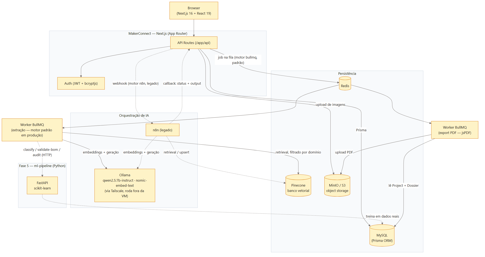</p>

Para atualizar: edite `scripts/diagrams/stack.mmd` e rode `node scripts/gerar-diagramas.mjs`.

---

## Arquitetura — Fluxo Principal

<p align="center">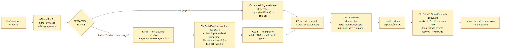</p>

Para atualizar: edite `scripts/diagrams/arquitetura-fluxo.mmd` e rode `node scripts/gerar-diagramas.mjs`.

---

## Algoritmos por Estágio

### Implementados hoje

| Estágio | Algoritmo / Técnica | Papel | Onde no código |
|---|---|---|---|
| Sanitização de PII | Regex determinístico (e-mail, telefone BR, CPF) | Remove dados pessoais antes de qualquer chamada externa — conformidade LGPD desde a entrada | `lib/lgpd.ts` |
| Extração de palavras-chave | Frequência de termos (bag-of-words) + stopwords PT-BR | Resume o texto a até 8 termos, usados como prompt de embedding quando presentes | `extractKeywords()` em `app/api/projects/[id]/extract/route.ts` |
| Embedding semântico | Rede neural pré-treinada `nomic-embed-text` (Ollama) | Converte o texto do projeto em vetor semântico pra busca por similaridade | `generateEmbedding()` em `lib/ollama.ts` |
| Busca vetorial (retrieval) | k-NN aproximado no índice Pinecone | Recupera as evidências técnicas mais similares que ancoram a geração, reduzindo alucinação | `queryByEmbedding()` em `lib/pinecone.ts` |
| Geração aumentada por recuperação (RAG) | LLM `qwen2.5:7b-instruct` (Ollama), temperatura 0.1 | Gera requisitos técnicos, BOM sugerida e código a partir do contexto recuperado | `generateCompletion()` em `lib/ollama.ts` + prompt em `lib/rag-output.ts` |
| Normalização de schema | Regras determinísticas (clamp, fallback, parsing defensivo de JSON) | Garante que a saída do LLM sempre respeite o schema `mc_extract_v2`, mesmo malformada | `normalizeExtractionOutput()` em `lib/rag-output.ts` |
| Orquestração assíncrona | Fila com backoff exponencial (BullMQ + Redis) | Desacopla a chamada do usuário do tempo de processamento (p50 ~53s) | `lib/extraction-queue.ts`, `lib/pdf-export-queue.ts` |

### Fase 5 — Pipeline de Estruturação (microsserviço Python)

Microsserviço FastAPI + scikit-learn separado (`ml-pipeline/`), chamado via HTTP pelo worker BullMQ. Segue a mesma filosofia do resto do pipeline: começa heurístico/regra e evolui pra modelos treinados conforme dados reais se acumulam — hoje a categoria já é um Naive Bayes treinado nos rótulos reais de `ProjectTag` (com fallback heurístico dado o dataset ainda pequeno), enquanto dificuldade e auditoria seguem heurísticos/baseados em regra por falta de rótulo real ainda (ver `ml-pipeline/README.md` para o detalhamento honesto de cada estágio):

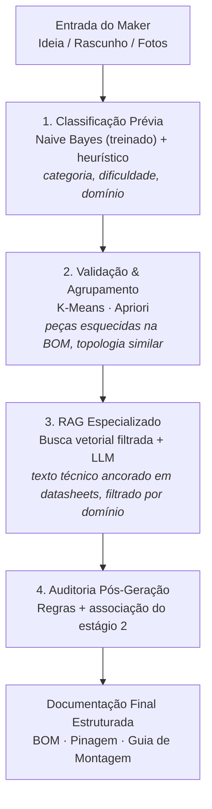

| Estágio | Algoritmo | Papel | Onde no código |
|---|---|---|---|
| 1. Classificação Prévia | Naive Bayes (TF-IDF) treinado em `ProjectTag` real, com fallback heurístico por palavra-chave (sem acento e por palavra inteira) | Define categoria, nível de dificuldade e domínios técnicos do projeto antes da geração | `ml-pipeline/app/stage1_classify.py` |
| 2. Validação & Agrupamento | K-Means (topologia de BOM) + Apriori (regras de associação) sobre BOMs reais, regras curadas de omissões clássicas e 16 regras de co-ocorrência mineradas de 54.599 artigos da Hackaday (só estatística agregada), com normalizador de componentes PT/EN | Detecta peças possivelmente esquecidas na BOM e agrupa projetos por topologia similar | `ml-pipeline/app/stage2_bom.py`, `ml-pipeline/app/components.py`, `ml-pipeline/app/external_bom_rules.json` |
| 3. RAG Especializado | Busca vetorial no Pinecone filtrada por domínio (metadata filter), com fallback automático sem filtro | Prioriza evidências técnicas do domínio do projeto (sensor/atuador/protocolo/...) antes da geração via LLM | `queryByEmbedding()` em `lib/pinecone.ts` + `lib/extraction-queue.ts` |
| 4. Auditoria Pós-Geração | Classificador baseado em regras (reaproveita as regras do estágio 2 + checagens de consistência BOM/requisitos) | Audita a saída gerada e sinaliza inconsistências/omissões antes da entrega final | `ml-pipeline/app/stage4_audit.py` |

O worker BullMQ (`lib/extraction-queue.ts`) chama o `ml-pipeline` via `lib/ml-pipeline.ts` de forma defensiva: se o serviço estiver fora do ar, os campos de previsão ficam `null` e o pipeline principal (Ollama/qwen) continua funcionando normalmente. Previsões e flags ficam disponíveis em `ProjectExtractionLog` (`predictedCategory`, `predictedDifficulty`, `predictedDomains`, `missingComponents`, `bomClusterLabel`, `auditScore`, `auditFlags`), retornados ao dono do projeto por `GET /api/projects/[id]/extract`.

**Avaliação em português:** `ml-pipeline/eval/` tem 80 projetos rotulados (20 por categoria, 13 casos difíceis) e um script que compara variantes do classificador. Em 21/10/2026 o caminho de produção acertava 50/80 (era 43/80 antes da correção de acento e palavra inteira no fallback). Detalhes no [README do ml-pipeline](maker-connect/ml-pipeline/README.md).

---

## Parâmetros dos Algoritmos de ML

Esta seção registra os valores configurados no código, e não só o nome do algoritmo, junto com o motivo de cada escolha e a literatura que a sustenta. Valores marcados como *(padrão)* não são passados explicitamente: vêm do default da biblioteca na versão fixada em `ml-pipeline/requirements.txt` (scikit-learn 1.6.0, mlxtend 0.23.4; PEDREGOSA et al., 2011; RASCHKA, 2018). Para reproduzir um resultado, basta manter essas versões e os parâmetros abaixo.

### Pré-processamento e palavras-chave

| Parâmetro | Valor | Onde |
|---|---|---|
| Normalização | minúsculas e remoção de pontuação (mantém letras e dígitos Unicode, inclusive acentos) | `extractKeywords()` em `app/api/projects/[id]/extract/route.ts` |
| Tamanho mínimo de token | 4 caracteres | idem |
| Stopwords | 20 palavras funcionais do português (*de, da, do, para, com, que...*) | idem |
| Palavras-chave mantidas | as 8 mais frequentes | idem |
| Texto enviado ao embedding | palavras-chave unidas por vírgula (até 12); sem palavras-chave, o texto sanitizado; corte em 600 caracteres | `buildEmbeddingPrompt()` em `lib/extraction-queue.ts` |

> **Fundamentação.** A lista curta de stopwords é deliberada. Manning, Raghavan e Schütze (2008, cap. 2) observam que os sistemas de recuperação de informação migraram de listas grandes (200 a 300 termos) para listas muito pequenas (7 a 12 termos) ou nenhuma, porque remover palavras demais prejudica consultas por frase. O corte por tamanho mínimo de 4 caracteres cumpre o papel das stopwords que ficaram de fora da lista.

### Sanitização de dados pessoais (LGPD)

| Dado | Padrão (regex) | Substituído por |
|---|---|---|
| E-mail | `[A-Z0-9._%+-]+@[A-Z0-9.-]+\.[A-Z]{2,}` (sem diferenciar maiúsculas) | `[EMAIL_REDACTED]` |
| Telefone BR | `(?:\+?55\s?)?(?:\(?\d{2}\)?\s?)?(?:9\d{4}\|\d{4})-?\d{4}` | `[PHONE_REDACTED]` |
| CPF | `\b\d{3}\.?\d{3}\.?\d{3}-?\d{2}\b` | `[CPF_REDACTED]` |

A ordem é e-mail, telefone e CPF, e o número de substituições e os tipos encontrados ficam no log de auditoria (`lib/lgpd.ts`).

> **Fundamentação.** A LGPD (BRASIL, 2018) estabelece o princípio da necessidade (art. 6º, III), que limita o tratamento ao mínimo necessário, e determina que dados anonimizados não são considerados dados pessoais (art. 12). Sanitizar antes de qualquer chamada de IA aplica o *privacy by design* de Cavoukian (2009): a privacidade como configuração padrão, e não como etapa opcional. **Limitação conhecida:** regex detecta formatos fixos; nomes próprios e endereços ainda não são removidos.

### Estágio 1 — Classificação prévia (`ml-pipeline/app/stage1_classify.py`)

**Categoria — TF-IDF + Naive Bayes multinomial, com fallback heurístico**

| Parâmetro | Valor | Por quê |
|---|---|---|
| `TfidfVectorizer.max_features` | 2000 | limita o vocabulário a um tamanho compatível com o dataset pequeno |
| `TfidfVectorizer.ngram_range` | (1, 2) | captura termos compostos ("impressora 3d", "ponte h") |
| `TfidfVectorizer.norm` / `lowercase` | `l2` / `True` *(padrão)* | vetores comparáveis independentemente do tamanho do texto |
| `MultinomialNB.alpha` | 1.0 *(padrão)* | suavização de Laplace: palavra nunca vista não zera a probabilidade da classe |
| `MIN_TRAINING_SAMPLES` | 8 | abaixo disso o modelo nem é treinado; usa só a heurística |
| `LOW_CONFIDENCE_THRESHOLD` | 0.6 | se a maior probabilidade do NB ficar abaixo de 0,6, vale a heurística |
| Casamento de palavra-chave | palavra inteira para termos de até 3 letras; prefixo para os demais | evita "pla" casar "placa" e "ble" casar "problema" |
| Confiança heurística | acertos da melhor categoria ÷ acertos totais | sem acerto nenhum, devolve `IoT` com confiança 0.0 (categoria mais comum) |

**Dificuldade — heurística, sem rótulo real ainda**

```text
pontuação  = 1,5 × (domínios técnicos distintos) + 0,3 × min(orações, 12)
normalizada = min(pontuação / 10, 1)
< 0,25 beginner · < 0,50 intermediate · < 0,75 advanced · senão expert
```

**Domínios** — 7 domínios (`MCU`, `Sensor`, `Protocol`, `Actuator`, `PowerMgmt`, `Display`, `Storage`), cada um com sua lista de palavras-chave. É a mesma taxonomia dos metadados do índice Pinecone, e por isso serve de filtro no estágio 3.

> **Fundamentação.** O Naive Bayes multinomial é a linha de base clássica para classificar texto (MANNING; RAGHAVAN; SCHÜTZE, 2008, cap. 13; JURAFSKY; MARTIN, 2025, cap. 4), e a suavização de Laplace é a correção padrão para palavras ausentes no treino. Manning, Raghavan e Schütze (2008) alertam, porém, que as **probabilidades** estimadas pelo NB são de baixa qualidade, embora suas **decisões** de classificação sejam surpreendentemente boas. Por isso o limiar de 0,6 é uma regra de engenharia, não uma probabilidade calibrada. Rennie et al. (2003) mostram que o NB favorece as classes com mais exemplos quando os dados são desbalanceados, que é exatamente o caso do dataset atual (por isso a variante `ComplementNB`, proposta por eles, foi testada na avaliação). Começar pela heurística e deixar o modelo ganhar peso conforme chegam dados segue a primeira regra de Zinkevich ([s. d.]):
>
> "Não tenha medo de lançar um produto sem aprendizado de máquina." (ZINKEVICH, [s. d.], regra nº 1, tradução nossa)

### Estágio 2 — Validação e agrupamento da BOM (`ml-pipeline/app/stage2_bom.py`)

**Regras de associação — Apriori**

| Parâmetro | Valor | Por quê |
|---|---|---|
| `MIN_TRANSACTIONS_FOR_RULES` | 5 | com menos BOMs reais, nenhuma regra é minerada |
| `min_support` | `max(0,15; 2/n)` | o conjunto de itens precisa aparecer em pelo menos 15% das BOMs e em no mínimo 2 delas |
| `association_rules(metric=...)` | `confidence`, `min_threshold=0.5` | só regras em que o consequente aparece em pelo menos metade dos casos |
| Consequente | só regras com 1 item | a sugestão vira "falta a peça X", fácil de entender |
| Regras curadas | 5 omissões clássicas (ESP32/ESP8266 sem regulador, relé sem diodo flyback, motor sem ponte H, sensor sem pull-up) com confiança fixa 0,6 | cobrem o domínio enquanto há poucas BOMs reais |
| Regras externas | 16 regras de co-ocorrência mineradas de 54.599 artigos da Hackaday, lift ≥ 4, confiança 0,09–0,56 | estatística agregada, nenhum texto; entram com a própria confiança, abaixo das curadas |
| Sugestões devolvidas | até 5, ordenadas por confiança | |

**Agrupamento por topologia — K-Means**

| Parâmetro | Valor | Por quê |
|---|---|---|
| Representação | TF-IDF sobre os itens da BOM, `max_features=500` | |
| `n_clusters` (k) | `min(3, n_transações)` | dataset pequeno; mais grupos que isso gera grupos de 1 item |
| `init` | `k-means++` *(padrão)* | sementes iniciais espalhadas |
| `n_init` | 10 | roda 10 inicializações e fica com a de menor inércia |
| `random_state` | 42 | resultado reproduzível entre execuções |
| Rótulo do grupo | os 3 termos de maior peso no centróide (ex.: `esp32-dht22-rele`) | legível para o usuário |

> **Fundamentação.** O Apriori (AGRAWAL; SRIKANT, 1994) explora a propriedade de que todo subconjunto de um conjunto frequente também é frequente, o que permite podar a busca usando o suporte mínimo. Han, Kamber e Pei (2011, cap. 6) mostram que regras "fortes" por suporte e confiança podem ser enganosas quando o consequente já é muito comum, e recomendam medidas de correlação como o *lift* (BRIN et al., 1997). Por isso as regras externas exigem lift ≥ 4 em vez de confiança alta. O K-Means é o algoritmo de Lloyd (1982); como ele só garante mínimo local, Hastie, Tibshirani e Friedman (2009, seção 14.3.6) recomendam várias inicializações aleatórias, que é o papel de `n_init=10`, e a inicialização k-means++ (ARTHUR; VASSILVITSKII, 2007) melhora a qualidade esperada da solução.

### Estágio 3 — RAG especializado

| Parâmetro | Valor | Onde |
|---|---|---|
| Modelo de embedding | `nomic-embed-text` via Ollama (vetores de 768 dimensões) | `lib/ollama.ts` |
| Timeout do embedding | 30 s | idem |
| Índice vetorial | Pinecone `maker-knowledge` (`PINECONE_INDEX`) | `lib/pinecone.ts` |
| `topK` | 3 evidências | `lib/extraction-queue.ts` |
| Filtro de metadados | `{ category: { $in: <domínios do estágio 1> } }`; sem resultado, repete a busca sem filtro | idem |
| Modelo gerador | `qwen2.5:7b-instruct` via Ollama | `lib/ollama.ts` |
| `temperature` | 0.1 | idem |
| `num_predict` | 500 tokens (`OLLAMA_NUM_PREDICT`) | idem |
| `format` / `stream` | `json` / `false` | idem |
| Timeout da geração | 180 s | idem |
| Schema da saída | `mc_extract_v2`, normalizado de forma defensiva | `lib/rag-output.ts` |

> **Fundamentação.** Lewis et al. (2020) definem o RAG como a combinação de uma memória paramétrica (os pesos do modelo) com uma memória não paramétrica (um índice denso consultado na hora da geração), o que permite atualizar o conhecimento sem retreinar e indicar de onde veio cada informação. Os modelos estão descritos em Nussbaum et al. (2024) e Qwen Team (2024). A temperatura baixa concentra a amostragem nos tokens mais prováveis (JURAFSKY; MARTIN, 2025): a saída fica mais determinística, que é o que se quer de um JSON técnico, não de um texto criativo. O `topK=3` mantém o prompt curto, o que pesa diretamente na latência em CPU. O fallback sem filtro existe para que o filtro de domínio nunca reduza a relevância validada no holdout. **Oportunidade de melhoria:** a Nomic recomenda os prefixos `search_query:` e `search_document:` no texto enviado ao embedding, e o pipeline ainda não os usa.

### Estágio 4 — Auditoria pós-geração (`ml-pipeline/app/stage4_audit.py`)

A nota começa em 100 e é limitada ao intervalo 0–100.

| Verificação | Desconto |
|---|---|
| BOM vazia | −30 |
| Nenhum requisito técnico | −20 |
| Diferença entre nº de itens da BOM e nº de requisitos maior que 3 | −10 |
| Confiança do modelo gerador < 50 | −15 |
| Nenhuma evidência RAG recuperada (risco de alucinação) | −20 |
| Peças possivelmente esquecidas (estágio 2) | até −20 no total, divididos entre as sugestões e ponderados pela confiança de cada uma |

> **Fundamentação.** Sculley et al. (2015) alertam que "é perigoso pensar nesses ganhos rápidos [do aprendizado de máquina] como se viessem de graça" (tradução nossa): todo modelo traz custo de manutenção. Sem auditorias humanas rotuladas, um classificador supervisionado aprenderia ruído, e regras explícitas são auditáveis e fáceis de explicar ao maker. Huyen (2022) recomenda justamente comparar qualquer modelo com uma linha de base heurística simples. O próximo passo previsto, quando houver rótulo, é o Isolation Forest (LIU; TING; ZHOU, 2008), que detecta saídas anômalas sem precisar de muitos exemplos negativos. Vale lembrar Box e Draper (1987): "todos os modelos estão errados, mas alguns são úteis" (tradução nossa).

### Avaliação

| Avaliação | Método | Parâmetros |
|---|---|---|
| Relevância RAG (`scripts/rag-eval.mjs`) | holdout de 10 projetos reais (H01–H10) | nota = 0,4 × cobertura de palavras-chave + 0,3 × confiança do modelo + 0,3 × completude da saída; meta ≥ 85% |
| Categoria (`ml-pipeline/eval/`) | 80 projetos rotulados (20 por categoria, 13 difíceis) | acerto quando a categoria prevista está entre as válidas |

> **Fundamentação.** Avaliar em dados que o modelo não viu no treino é a forma de estimar o erro de generalização (HASTIE; TIBSHIRANI; FRIEDMAN, 2009, cap. 7); por isso os projetos `[EVAL]` são excluídos das consultas de treino em `app/db.py`. Com apenas 10 casos no holdout, cada projeto vale 10 pontos percentuais: os 95–98% indicam que o pipeline funciona, mas não permitem distinguir variantes próximas. Ampliar o holdout é condição para comparações finas (MANNING; RAGHAVAN; SCHÜTZE, 2008, cap. 8).

---

## Boas Práticas de Engenharia Aplicadas

| Prática | Como está no código | Fundamentação |
|---|---|---|
| Processamento assíncrono com fila | Extração e PDF rodam em filas BullMQ; a requisição do usuário só enfileira e devolve o status (`queued` → `processing` → `done`/`failed`) | Kleppmann (2017, cap. 11): filas desacoplam quem produz do ritmo de quem processa |
| Retentativa com backoff exponencial | `attempts: 3`, `backoff: exponential`, `delay: 1500` ms (esperas de 1,5 s e 3 s) | Brooker (2015) mostra que espaçar retentativas evita sobrecarregar um serviço que já está falhando. Ainda sem *jitter*; com concorrência 1, o impacto é pequeno |
| Timeouts explícitos em toda integração | embedding 30 s, geração 180 s, ml-pipeline 5 s | Nygard (2018, cap. 5): toda chamada de rede sem timeout é um ponto em que o sistema inteiro pode travar |
| Degradação graciosa | se o ml-pipeline cair, os campos de previsão ficam `null` e a extração segue (`lib/ml-pipeline.ts`) | Nygard (2018): uma dependência auxiliar não pode derrubar o fluxo principal |
| Idempotência | upvote com chave única composta (usuário, projeto) | Kleppmann (2017): operações idempotentes tornam retentativas seguras |
| Latência por percentis | painel com p50 e p95, não só a média | Beyer et al. (2016, cap. 4): a média esconde a cauda, que é o que o usuário mais lento sente |
| Limite de taxa | janela fixa no Redis: login 20/15 min por IP e 5/15 min por e-mail; cadastro 5/h por IP; extração 10/h e PDF 20/h por usuário (`lib/rate-limit.ts`) | Beyer et al. (2016, cap. 21): rejeitar cedo o excesso protege os recursos caros, como o LLM |
| Concorrência controlada | `EXTRACTION_WORKER_CONCURRENCY` e `PDF_EXPORT_WORKER_CONCURRENCY`, padrão 1 | o Ollama em CPU satura com um job; paralelizar só aumenta a latência de todos |
| Saída da IA imutável | a edição do dono vai para `ProjectDossier`; a saída original da IA fica intocada em `ProjectExtractionLog` | Kleppmann (2017, cap. 11): registros imutáveis permitem auditar e reconstruir o estado |
| Retenção de jobs | `removeOnComplete: 50`, `removeOnFail: 100` | mantém histórico para diagnóstico sem deixar o Redis crescer sem limite |
| Privacidade desde a entrada | sanitização LGPD antes de qualquer chamada de IA | Cavoukian (2009); BRASIL (2018) |

---

## Segurança e Privacidade

- **Termos de Uso** e **Política de Privacidade** públicos em [makerconnect.com.br/termos](https://makerconnect.com.br/termos) e [/privacidade](https://makerconnect.com.br/privacidade), escritos a partir do que o código faz (dados coletados, cookie único de sessão, anonimização antes da IA, fornecedores, direitos do titular pela LGPD).
- **Autenticação em duas camadas:** o middleware (`proxy.ts`) exige sessão em todas as páginas e em todo `/api/*`, com uma lista pública explícita; cada rota ainda verifica se o usuário é dono do recurso ou pode vê-lo.
- **Rate limiting** com Redis no login, cadastro, extração por IA e geração de PDF.
- **LGPD:** e-mail, telefone e CPF são removidos do texto antes de qualquer chamada de IA, com registro de auditoria.

As regras para quem desenvolve (como proteger uma rota nova, o que nunca devolver de um usuário) estão em [`maker-connect/README.md`](maker-connect/README.md#segurança-e-autorização), junto com a lista de dívidas técnicas conhecidas.

---

## Status (21/10/2026)

| Entrega | Status |
|---------|--------|
| Next.js + Prisma + MySQL | Concluído |
| Feed com filtros, busca, paginação | Concluído |
| Fork com linhagem (`parentId`) | Concluído |
| Upvote idempotente | Concluído |
| Log de dificuldades | Concluído |
| Pipeline IA (extração + RAG + callback) | Concluído |
| LGPD — anonimização PII + audit trail | Concluído |
| Métricas operacionais (p50/p95/relevance) | Concluído |
| Comunidades públicas e privadas | Concluído |
| Posts com mídia + membership approval | Concluído |
| Autenticação JWT | Concluído |
| Cadastro de robôs e equipes | Concluído |
| Exportação PDF assíncrona (BullMQ) — logo, link do projeto, tópicos (Dossiê) | Concluído |
| Motor de extração BullMQ como padrão em produção (n8n mantido como legado) | Concluído |
| Dossiê Técnico editável (requisitos/BOM/etapas, vídeo, galeria de imagens) | Concluído |
| Fase 5 — pipeline de estruturação (ml-pipeline) | Concluído — dataset real ainda pequeno, ver `ml-pipeline/README.md` |
| Regras de BOM externas (Hackaday) + avaliação de categoria em português | Concluído |
| Produção migrada da Azure para VPS Hostinger | Concluído |
| Termos de Uso e Política de Privacidade (LGPD) | Concluído — pendências operacionais em `maker-connect/README.md` |
| Autenticação em toda a API, checagem de dono e rate limiting | Concluído |
| Gate S1.1 | PASS (28/04/2026) |
| Gate S1.2 | PASS (13/05/2026) |
| Gate S1.3 | Partial PASS — relevance 98% ✅, latência ⚠️ (sem GPU) |
| Gate S1.4 | latência sem GPU melhorou pra p95 ~46s (era 137s) com BullMQ + Fase 5; ainda acima da meta de <15s |
| Suite de testes | 389 testes / 0 falhas (Jest: 359 em 45 suítes; Pytest: 30) |
| RAG relevance (holdout H01-H10) | 95–98% conforme motor/rodada (meta: ≥ 85%) |

---

## Evolução do Projeto

Registro das principais entregas por período, com base no histórico de commits do repositório.

**Fundação (até Ago/2026)** — autenticação JWT e login social (Google/GitHub), feed social com fork de linhagem e upvote idempotente, log de dificuldades, pipeline de IA (extração + RAG + callback) com conformidade LGPD, comunidades públicas/privadas, cadastro de robôs e equipes, deploy inicial em produção (Azure, CI/CD via GitHub Actions).

| Data | Entrega |
|------|---------|
| 04/09 | Landing pública com dados reais e origem acadêmica; `/admin/metrics` restrito a administrador, com visão geral de Redis, MinIO e Pinecone |
| 10/09 | Bug corrigido: criador de Comunidade/Equipe deixou de cair em usuário fixo — passou a usar a sessão autenticada real |
| 10/09 | "Feed" renomeado para **Projetos** (rota `/feed` → `/projects`, com redirect de compatibilidade); "Robôs" saiu do menu principal e passou a ser uma aba dentro da página de Equipe |
| 10/09 | Sistema de afiliação de Equipe: entrar direto (pública) ou solicitar afiliação (privada) com aprovação do dono/admin, e opção de adicionar membro diretamente por busca |
| 11/09 | Projeto passou de categoria única para **múltiplas tags**, com **visibilidade em 3 níveis** (pública / privada-só-eu / privada-para-minha-equipe) e novos campos **Objetivo** e **Componentes** no cadastro |
| 11/09 | Nova subseção **Competições** dentro da página de Equipe: dono/admin registra a competição, vincula robôs da equipe e publica o resultado depois |
| 11/09 | Pipeline de extração passa a rodar em **motor duplo** (n8n ou BullMQ, via `EXTRACTION_ENGINE`) — mesmo prompt e normalização do n8n portados verbatim pra `lib/rag-output.ts`, callback do n8n mantido como rede de segurança |
| 11/09 | **Fase 5** implementada: microsserviço Python (`ml-pipeline/`) com classificação prévia (Naive Bayes treinado), validação/agrupamento de BOM (K-Means + Apriori), filtro de domínio no RAG e auditoria pós-geração — chamado de forma defensiva pelo worker BullMQ |
| 12/09 | **BullMQ vira o motor padrão em produção** (antes era n8n) — Ollama passou a ser chamado direto via Tailscale, sem passar pelo n8n; corrigido bug de deploy em que o nginx ficava com o IP antigo do container após cada release |
| 12/09 | **Dossiê Técnico** deixou de ser um placeholder estático: vira editável (requisitos, BOM e **etapas de montagem** — novo campo gerado pela IA), com link de vídeo (YouTube) e galeria de imagens; edição do dono nunca sobrescreve a saída original da IA, preservada para auditoria em um registro `ProjectDossier` separado |
| 12/09 | **PDF exportado** passa a puxar do Dossiê (não mais do output bruto da extração): logo atualizado pra bater com a marca atual, link clicável do projeto e do vídeo, conteúdo organizado em tópicos (Visão Geral, Requisitos, BOM, Etapas de Montagem, Código) |
| 16/10 | **Produção migra da Azure para um VPS Hostinger** (créditos da Azure esgotados); MinIO trocado pela imagem da Chainguard e painel admin passa a mostrar a infraestrutura do VPS |
| 17/10 | Modal de criação de projeto maior e guiado, com sugestão por IA e link de vídeo; correção da distorção do logo no PDF |
| 21/10 | 8 **projetos de demonstração** completos em produção, com capas ilustradas (`prisma/seed-showcase-projects.cjs`) |
| 21/10 | **Fase 5 com dados externos:** regras de co-ocorrência de componentes mineradas da Hackaday no estágio 2 e conjunto de avaliação de categoria em português |
| 21/10 | Seção **"Nossa história"** na home (do *Make Do and Mend* à cultura maker), com linha do tempo, fontes e imagens de licença livre |
| 21/10 | **Termos de Uso e Política de Privacidade** publicados |
| 21/10 | **Correções de segurança:** autenticação em toda a API, checagem de dono nas rotas de usuário e projeto, rate limiting, Next.js 16.4.2 e fim do `ignoreBuildErrors` |

---

## Cronograma do Projeto

O cronograma completo está disponível em formato Excel para uso no relatório:

**[docs/cronograma-makerconnect-2026.xlsx](docs/cronograma-makerconnect-2026.xlsx)** — 2 abas: Cronograma (4 fases, 16 semanas, 67 entregas) + Gates e Métricas

Para regenerar: `cd maker-connect && node ../scripts/gerar-cronograma.mjs`

| Fase | Período | Foco | Status |
|------|---------|------|--------|
| Fase 1 — Foundation + Pipeline IA | Abr – Jun 2026 | Auth, feed social, RAG, LGPD, comunidades, robôs | Concluída |
| Fase 2 — MVP Completo | Jun – Jul 2026 | PDF export assíncrono (BullMQ), E2E flows, infra GPU | Em andamento |
| Fase 3 — Qualidade e Docs | Jul – Set 2026 | Cobertura > 80%, ADRs, C4 diagram, slides da banca | Pendente |
| Fase 4 — Banca e Entrega | Set – Nov 2026 | Ensaios, cleanup final, defesa TCC | Pendente |

**Gates de validação:**

| Gate | Data | Resultado |
|------|------|-----------|
| S1.1 | 28/04/2026 | PASS — pipeline E2E em ~49s |
| S1.2 | 13/05/2026 | PASS — audit trail LGPD + 161 testes |
| S1.3 | 27/05/2026 | Partial — relevance 98% ✓ / latência 137s s/ GPU |
| S1.4 | 25/06/2026 (previsto) | Pendente — PDF export + latência < 15s |

---

## Telas do Sistema

Screenshots capturadas em 04/06/2026 via Playwright (1440×900). Para atualizar: `cd maker-connect && node ../scripts/screenshot-all.mjs`

<table>
  <tr>
    <td align="center" width="50%">
      
      <br><b>01 — Página Inicial</b>
    </td>
    <td align="center" width="50%">
      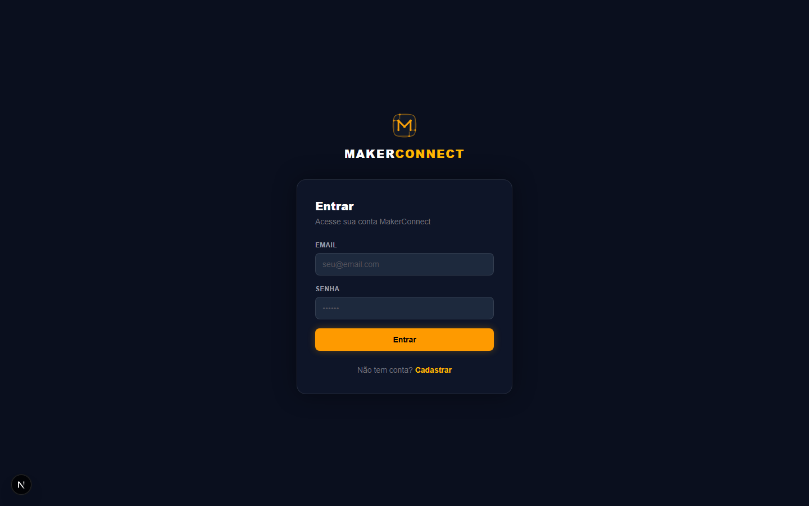
      <br><b>02 — Login</b>
    </td>
  </tr>
  <tr>
    <td align="center" width="50%">
      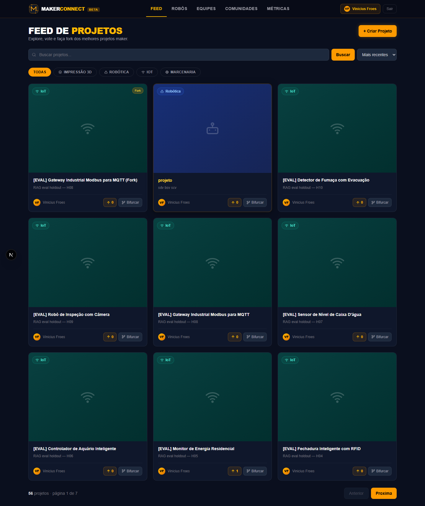
      <br><b>03 — Feed de Projetos</b>
    </td>
    <td align="center" width="50%">
      
      <br><b>04 — Feed — Filtro Robótica</b>
    </td>
  </tr>
  <tr>
    <td align="center" width="50%">
      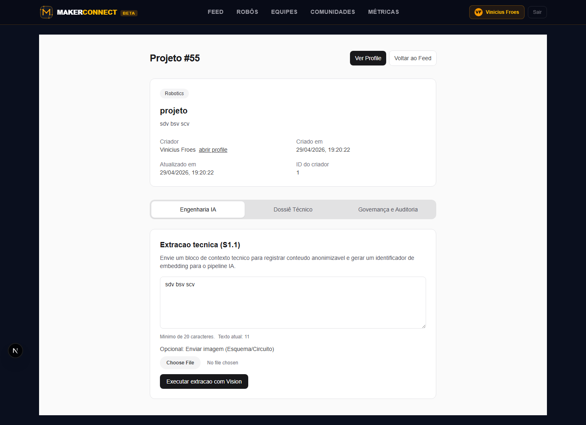
      <br><b>05 — Detalhe do Projeto</b>
    </td>
    <td align="center" width="50%">
      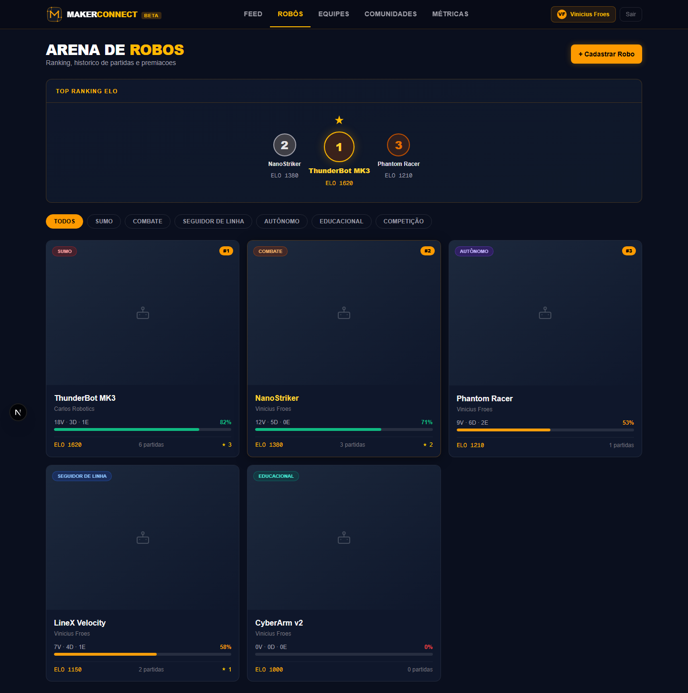
      <br><b>06 — Lista de Robôs (Ranking ELO)</b>
    </td>
  </tr>
  <tr>
    <td align="center" width="50%">
      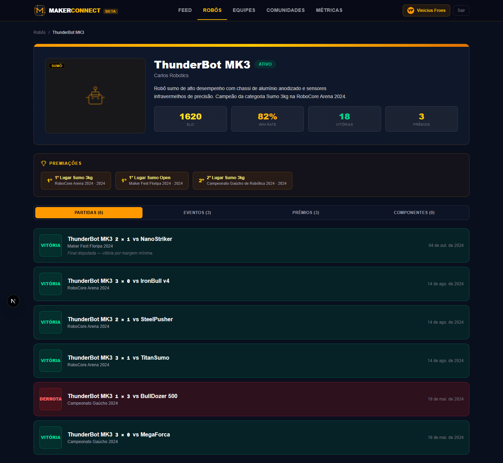
      <br><b>07 — Detalhe do Robô</b>
    </td>
    <td align="center" width="50%">
      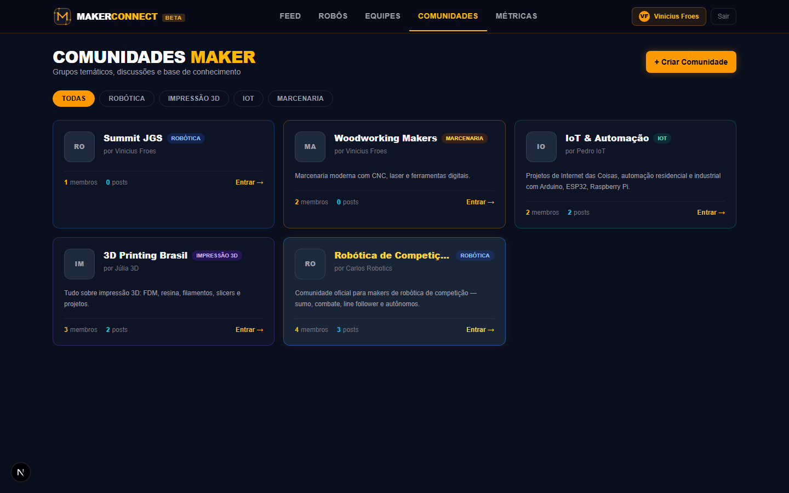
      <br><b>08 — Comunidades</b>
    </td>
  </tr>
  <tr>
    <td align="center" width="50%">
      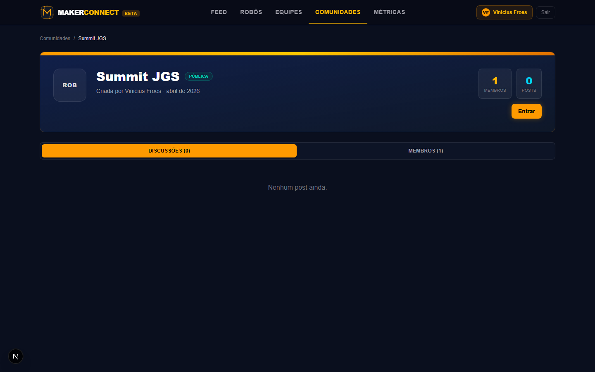
      <br><b>09 — Detalhe da Comunidade</b>
    </td>
    <td align="center" width="50%">
      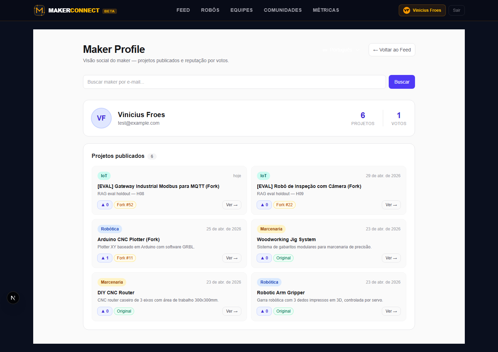
      <br><b>10 — Perfil do Usuário</b>
    </td>
  </tr>
  <tr>
    <td align="center" width="50%">
      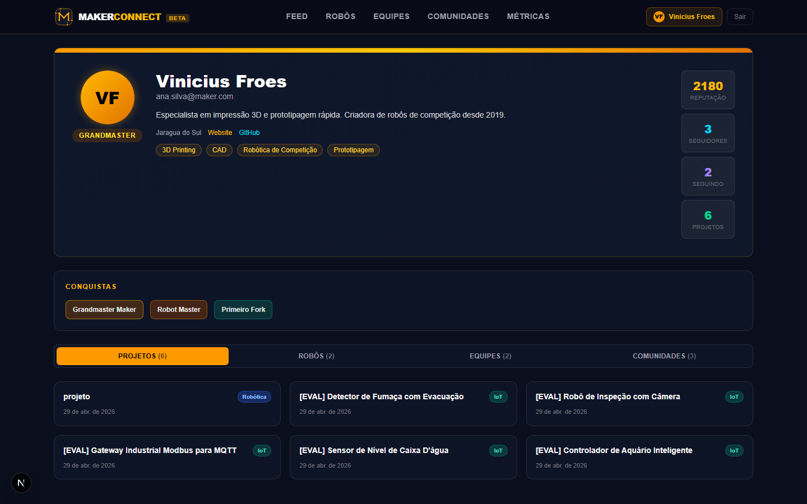
      <br><b>11 — Perfil Público</b>
    </td>
    <td align="center" width="50%">
      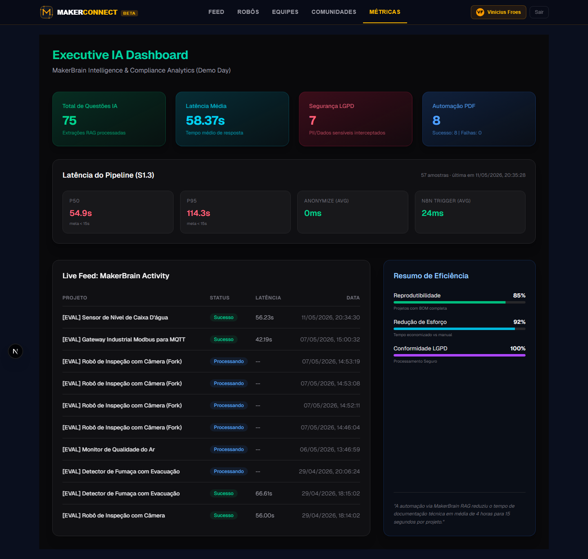
      <br><b>12 — Dashboard de Métricas IA</b>
    </td>
  </tr>
  <tr>
    <td align="center" width="50%">
      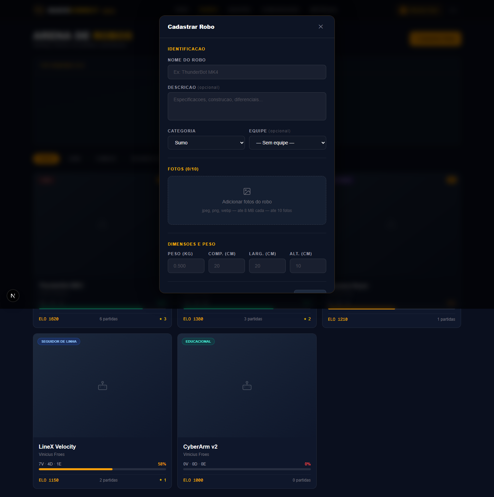
      <br><b>13 — Cadastro de Robô</b>
    </td>
    <td align="center" width="50%">
      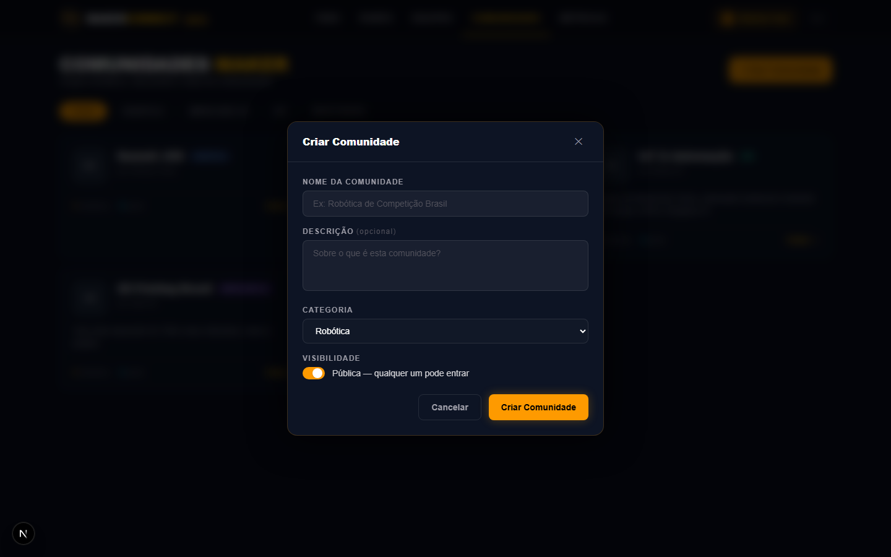
      <br><b>14 — Criar Comunidade</b>
    </td>
  </tr>
  <tr>
    <td align="center" width="50%">
      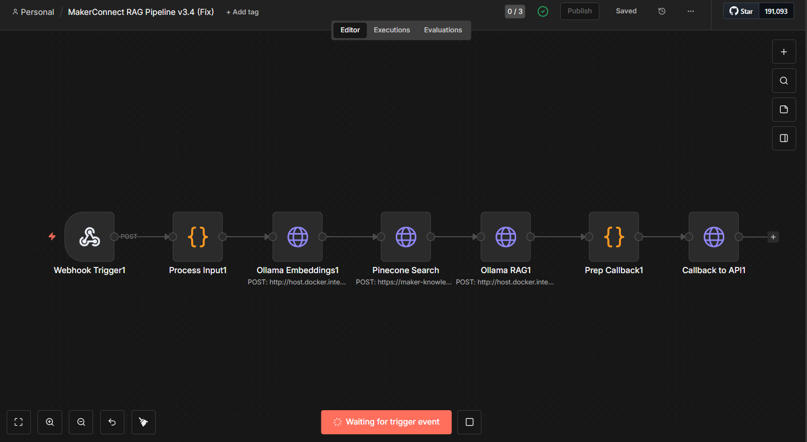
      <br><b>15 — Workflow n8n (Orquestração IA)</b>
    </td>
    <td align="center" width="50%">
      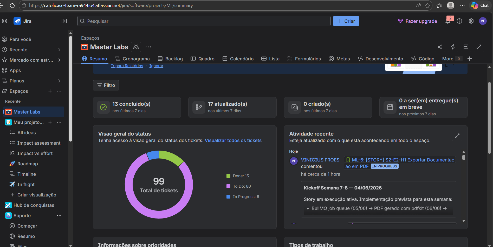
      <br><b>16 — Board Jira (Gestão do Projeto)</b>
    </td>
  </tr>
</table>

---

## Como Executar

### 1. Pré-requisitos

- Node.js 20+
- Python 3.12+ (pipeline de estruturação — `ml-pipeline/`)
- MySQL 8 (ou Docker)
- MinIO ou bucket S3 configurado
- Ollama com modelos `qwen2.5:7b-instruct` e `nomic-embed-text`
- Redis (para BullMQ)
- n8n rodando e acessível — opcional, só necessário se `EXTRACTION_ENGINE=n8n` (motor legado; o padrão é `bullmq`)

### 2. Clonar e instalar

```bash
git clone https://github.com/Froesv85/Master-Labs.git
cd Master-Labs/maker-connect
npm install
```

### 3. Variáveis de ambiente

```bash
cp .env.example .env.local
# os valores do exemplo já servem para a infra local; preencha pelo menos JWT_SECRET,
# PINECONE_API_KEY e OLLAMA_BASE_URL (todas as variáveis estão comentadas no arquivo)
```

### 4. Infra local (Docker)

```bash
docker compose up -d mysql redis minio createbuckets ml-pipeline
```

### 5. Banco de dados

```bash
npx prisma migrate dev
npx prisma db seed
```

### 6. Executar

```bash
npm run dev        # dev server em http://localhost:3000
npm test           # testes Jest (359)
```

Detalhes, problemas conhecidos (inclusive o build em disco FAT32 no Windows), deploy e operação em produção: [`maker-connect/README.md`](maker-connect/README.md).

---

## Estrutura do Repositório

```
Master-Labs/
├── maker-connect/          # aplicação principal (Next.js + API + Prisma) — ver o README de lá
│   ├── app/                # páginas e rotas de API
│   ├── components/         # componentes compartilhados (logo, história, páginas legais...)
│   ├── lib/                # serviços: auth, prisma, project-access, rate-limit, lgpd, s3,
│   │                       #   ollama, pinecone, extraction-queue.ts e pdf-export-queue.ts
│   │                       #   (workers BullMQ, in-process, sem pasta dedicada)
│   ├── ml-pipeline/        # Fase 5 — microsserviço Python (FastAPI + scikit-learn) + eval/
│   ├── __tests__/          # 45 suítes de testes (Jest)
│   ├── prisma/             # schema, migrations, seed e seed dos projetos de demonstração
│   ├── proxy.ts            # middleware de autenticação
│   ├── backend/            # LEGADO: backend Express/Knex da primeira fase, não usado
│   └── scripts/            # rag-eval, seed-passwords, etc. (local-only, fora do git)
├── nginx/                  # configuração do nginx de produção
├── docker-compose.prod.yml # stack de produção no VPS
├── .github/workflows/      # deploy.yml (build das imagens + deploy por SSH)
├── assets/                 # diagramas e screenshots usados neste README
├── docs/                   # documentação: planning, architecture, ai, tcc (local-only, fora do git)
├── scripts/                # automações operacionais: Jira, diagramas (local-only, fora do git)
└── README.md               # este arquivo
```

---

