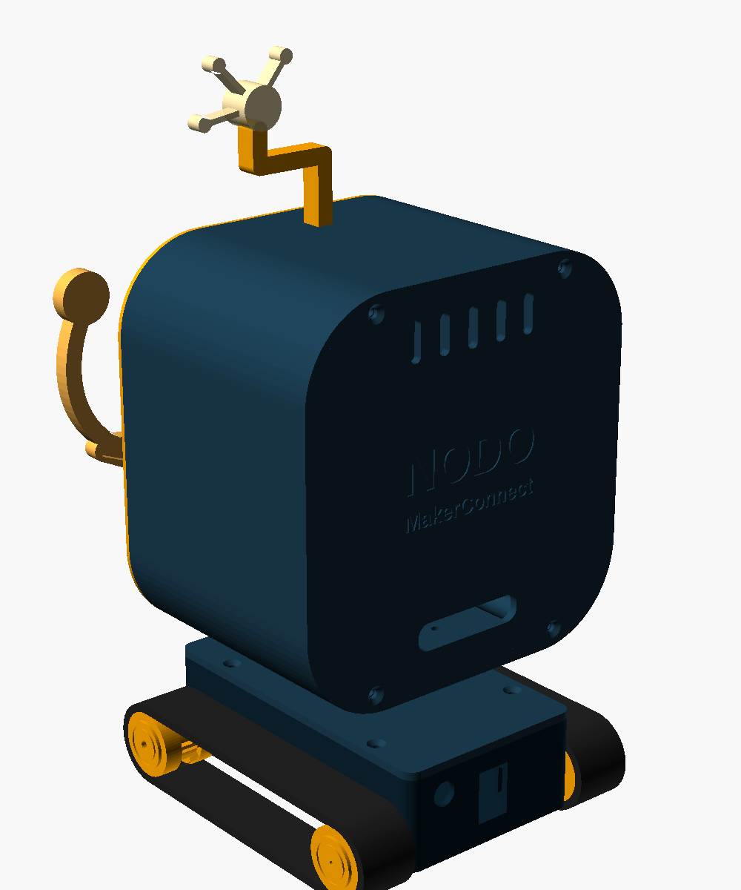

# Nodo — robô físico do mascote MakerConnect

Robô autônomo de ~26 cm, com esteiras. Passeia sozinho, desvia de obstáculos, para para "olhar em volta" e **acena** quando alguém chega perto. O rosto é uma tela e a antena acende.


```
nodo-robot/
├── cad/nodo.scad          modelo paramétrico (OpenSCAD) — todas as medidas no topo do arquivo
├── cad/stl/*.stl          peças prontas, já na orientação de impressão
├── firmware/nodo/nodo.ino código do ESP32 (Arduino IDE)
├── firmware/platformio.ini mesmo código para PlatformIO
└── img/                   renders da montagem
```

---

## 1. Lista de materiais

### Eletrônica

| Qtd | Item | Observação |
|---|---|---|
| 1 | ESP32 DevKit V1 (30 pinos) | cérebro |
| 1 | Driver TB6612FNG | 2 canais, 1,2 A contínuo |
| 2 | Motor N20 6 V 1:150 (eixo D 3 mm) | ~200 rpm; 1:100 deixa mais rápido, 1:298 mais forte |
| 1 | Tela TFT 2,8" ILI9341 SPI (placa 86×50 mm) | rosto |
| 1 | Sensor ultrassônico HC-SR04 | fica no peito |
| 1 | Micro servo SG90 ou MG90S | braço que acena (MG90S tem engrenagem metálica) |
| 1 | LED endereçável PL9823 F8 (8 mm) | nó da antena. Alternativa: WS2812 numa plaquinha redonda de 8–10 mm |
| 2 | Células 18650 + suporte 2S + BMS 2S | 7,4 V nominal |
| 1 | Conversor buck 5 V ≥ 3 A (LM2596 ou MP1584) | ajuste para 5,0 V **antes** de ligar no ESP32 |
| 1 | Chave gangorra KCD11 | furo 12,9 × 19,2 mm |
| 1 | Placa perfurada 7 × 9 cm | vai presa na tampa traseira |
| — | Resistores 1 kΩ, 2 kΩ, 100 kΩ, 33 kΩ, 330 Ω; diodo 1N4148; capacitor 470 µF 10 V | divisores, LED, servo |

### Parafusos

| Qtd | Item | Onde |
|---|---|---|
| 13 | M3 × 8 | tampa traseira (4), deck no chassi (4), corpo no pescoço (4), braço esquerdo (1) |
| 2 | M3 × 30 + porca autotravante | eixo das rodas-guia |
| 4 | M2,5 × 5 | tela |
| 4 | M2,5 × 6 | placa perfurada |
| 2 | M2 × 6 | abas do servo |

### Filamento

| Cor sugerida | Material | Peças |
|---|---|---|
| Azul-petróleo `#1A3A4D` | PLA | `body_shell`, `body_back`, `deck` |
| Azul bem escuro ou preto | PLA | `chassis`, `visor_insert`, `chest_insert` |
| Laranja `#FFA500` | PLA | `face_frame`, `arm_left`, `arm_right`, `antenna_front`, `antenna_back`, `cheek` ×2, `sprocket_drive` ×2, `sprocket_idler` ×2, `chest_trace` |
| Translúcido / natural | PETG | `antenna_node` (o LED brilha através dela) |
| Preto | **TPU 95A** | `track` ×2 |

---

## 2. Impressão

As peças já saem na orientação correta e **nenhuma precisa de suporte**.

| Peça | Qtd | Camada | Paredes / preenchimento | Notas |
|---|---|---|---|---|
| body_shell | 1 | 0,2 | 3 / 12 % | impressa com a face na mesa (136 × 141 × 95 mm) |
| body_back | 1 | 0,2 | 3 / 15 % | texto gravado na face da mesa |
| chassis, deck | 1 cada | 0,2 | 3 / 20 % | |
| sprocket_drive / idler | 2 / 2 | 0,12 | 4 / 50 % | precisão importa: furo em D de 3 mm |
| track | 2 | 0,2 | 3 / 100 % | TPU, 20–25 mm/s, sem retração ou com pouca |
| braços, antena, inserts | — | 0,12–0,16 | 3 / 30 % | |

> **Teste antes**: imprima um `sprocket_drive` e encaixe no motor. Se ficar frouxo ou apertado, ajuste o diâmetro do furo em D na função `sprocket()` do `nodo.scad`. Depois imprima os outros.

---

## 3. Ligação

```
 BATERIA 2S ──BMS── P+ ──[CHAVE]──┬── VM do TB6612
                                   ├── IN+ do buck 5 V ──┬── VIN do ESP32
                                   │                      ├── V+ do servo (+ capacitor 470 µF)
                                   │                      ├── VCC do HC-SR04
                                   │                      ├── VCC da tela
                                   │                      └── 1N4148 ──► VDD do LED (≈4,3 V)
                                   └── 100 kΩ ──┬── GPIO 34
                                               33 kΩ
                                                └── GND
 Todos os GND juntos.
```

| Componente | Pino | ESP32 |
|---|---|---|
| TB6612 | PWMA / AIN1 / AIN2 (esteira esquerda) | 25 / 26 / 27 |
| | PWMB / BIN1 / BIN2 (esteira direita) | 14 / 33 / 32 |
| | VCC, STBY | 3V3 |
| | AO1/AO2 → motor esquerdo, BO1/BO2 → motor direito | — |
| Tela ILI9341 | SCK / SDI(MOSI) / CS / DC / RESET | 18 / 23 / 5 / 16 / 17 |
| | LED (luz de fundo) | 3V3 |
| | SDO (MISO) | não ligar |
| HC-SR04 | TRIG | 21 |
| | ECHO → 1 kΩ → **GPIO 22** → 2 kΩ → GND | 22 (o divisor protege o ESP32 dos 5 V) |
| Servo | sinal (laranja) | 13 |
| LED da antena | DIN (com resistor de 330 Ω em série) | 4 |
| Bateria | meio do divisor 100 k / 33 k | 34 |

Fios do LED: 3 fios finos (wire-wrap 30 AWG) correm pelo canal dentro da antena.

---

## 4. Montagem

**Base**
1. Empurre cada motor N20 por dentro do túnel até a caixa de redução encostar na parede lateral. O eixo sai pelo furo. Um ponto de cola quente prende o motor.
2. Encaixe as rodas `sprocket_drive` nos eixos em D (lado com furo voltado para o chassi). Elas ficam na **traseira**.
3. Na **frente**, passe o M3 × 30 por dentro da `sprocket_idler`, pelo rasgo da lateral, e coloque a porca autotravante por dentro. Deixe a roda girar livre.
4. Coloque a esteira de TPU, deslize a roda-guia para a frente no rasgo até a esteira ficar firme (sem esticar demais) e aperte a porca.
5. Instale o suporte 2S + BMS no meio do chassi, a chave na parede traseira e passe os fios de energia e dos motores pelo furo central do deck.
6. Parafuse o `deck` no chassi (4 × M3 × 8).

**Corpo**
7. Cole a `face_frame` (moldura laranja), o `visor_insert` com os dois `cheek`, e o `chest_insert` com o `chest_trace` (cola instantânea).
8. Prenda a tela nos 4 pinos atrás do visor. Encaixe os transdutores do HC-SR04 nos dois furos do peito e fixe a placa com cola quente.
9. Servo: o domo de engrenagem passa pelo furo à direita da face e as abas vão nos dois pinos (M2 × 6).
10. Antena: coloque o LED PL9823 no `antenna_node` com as pernas para baixo. Solde os 3 fios, deite-os no canal da `antenna_back`, cole a `antenna_front` por cima e cole o nó no topo. Encaixe o pino da antena na fenda do topo do corpo.
11. Monte ESP32, TB6612, buck e resistores na placa perfurada e prenda-a na `body_back`.
12. Assente o corpo sobre o pescoço e parafuse por dentro (4 × M3 × 8). Ligue os conectores e feche a tampa.

**Braços**
13. Braço esquerdo: um M3 × 8 por dentro da face, rosqueando no ressalto do braço.
14. Braço direito: grave o firmware **antes**. Na partida, o servo vai para `ARM_UP` (braço levantado). Com ele nessa posição, encaixe o horn simples na peça `arm_right` já na pose do mascote, coloque no eixo do servo e aperte o parafuso do horn pelo furo da frente.



---

## 5. Firmware

1. Na Arduino IDE, instale a placa **esp32 by Espressif** (versão 2.x ou 3.x).
2. Instale as bibliotecas **Adafruit GFX**, **Adafruit ILI9341**, **Adafruit NeoPixel** e **ESP32Servo**.
3. Abra `firmware/nodo/nodo.ino`, escolha **ESP32 Dev Module** e envie.

Ou, no PlatformIO, rode `pio run -t upload` dentro de `firmware/`.

**O que ele faz** (máquina de estados):

| Estado | Rosto | Antena | Ação |
|---|---|---|---|
| Passeio | sorriso, piscando | laranja "respirando" | anda para a frente |
| Obstáculo < 25 cm | surpreso (ideia) | pisca laranja | ré, gira para um lado aleatório até liberar |
| Pausa (a cada 12–25 s) | olha para os lados | — | para por ~3,5 s |
| Alguém a 20–80 cm durante a pausa | sorriso | arco-íris | **acena 3 vezes** e vira |
| Comemoração (a cada 30–60 s) | comemorando | arco-íris | dancinha e aceno |
| Bateria < 6,6 V | dormindo "z z" | vermelho fraco | para tudo |

**Primeiros testes (com o robô suspenso, esteiras sem tocar a mesa)**
- Abra o Monitor Serial em 115200. Ele mostra estado, distância e tensão da bateria a cada segundo.
- Se uma esteira girar ao contrário, mude `MOTOR_L_INVERT` ou `MOTOR_R_INVERT`.
- Se o rosto ficar de ponta-cabeça, troque `TFT_ROTATION` entre 1 e 3.
- Se o braço mexer para o lado errado, troque os valores de `ARM_UP` e `ARM_DOWN`.
- Se a antena ficar com as cores trocadas, use `NEO_GRB` em vez de `NEO_RGB` (é o caso da WS2812).
- Ligado só no USB, sem bateria, a proteção de bateria fraca fica desligada automaticamente.

---

## 6. Ajustes no modelo 3D (`cad/nodo.scad`)

Todas as medidas importantes estão no topo do arquivo. **Meça antes de imprimir o corpo**:

| Parâmetro | O que é |
|---|---|
| `WIN`, `WIN_OFF` | tamanho e deslocamento da área visível da tela (alguns módulos têm a área ativa fora do centro da placa) |
| `DH`, `DISP_SO` | distância entre os furos da tela e altura dos pinos |
| `SONAR`, `SONAR_D` | posição e diâmetro dos transdutores do HC-SR04 |
| `SV_TABS`, `SV_TAB`, `SV_OFF` | medidas do servo (SG90 e MG90S são iguais) |
| `BD` | profundidade do corpo (95 mm) |
| `NL`, `TW` | número de garras e largura da esteira |

Para exportar uma peça: `openscad -D 'part="body_shell"' -o body_shell.stl nodo.scad` (a lista de peças está no topo do arquivo).

**Carregar a bateria**: passe o cabo de balanceamento 2S (JST-XH) para fora pelo furo redondo da traseira do chassi e use um carregador 2S. Outra opção é instalar um módulo de carga USB-C para 2S nesse furo.

---

## 7. Opção: esteira articulada em PLA (sem TPU)

Arquivo `cad/esteira_pla.scad` e STLs em `cad/stl/esteira_pla/`. A esteira é de **elos rígidos unidos por pinos de filamento de 1,75 mm**, como uma corrente. O chassi é o mesmo: passo de 8,17 mm, 36 elos por lado e a mesma distância entre eixos.

> Use as rodas dentadas desta pasta (`esteira_pla/sprocket_*.stl`), **não** as da esteira de TPU. A garra fica no meio de cada elo e a roda tem aros mais baixos para deixar as dobradiças passarem.

| Peça | Qtd | Notas |
|---|---|---|
| `link.stl` / `link_plate.stl` | 72 elos (4 placas de 18) | já em pé: furo do pino na vertical, sai redondo e preciso. Use brim de 3 mm |
| `sprocket_drive.stl` | 2 | furo em D para o N20 |
| `sprocket_idler.stl` | 2 | furo de 3,4 mm para o eixo M3 |
| `pin_jig.stl` | 1 | gabarito para cortar os pinos todos com 23 mm |
| Filamento 1,75 mm (PLA ou PETG) | 72 pedaços de 23 mm | são os pinos |

**Impressão dos elos**: PLA, camada 0,12–0,16 mm, 3 paredes, 40 % de preenchimento, sem suporte. Imprima **um elo de teste** primeiro. O pino de filamento precisa passar e **girar livre**: se travar, aumente `HOLE_D` (1,95 → 2,05); se ficar com folga demais, diminua para 1,85.

**Montagem**
1. Corte 72 pinos no gabarito (filamento dentro do canal, corte rente às pontas).
2. Encaixe dois elos (as dobradiças intercalam), empurre o pino e amasse levemente as duas pontas com a ponta do ferro de solda morna (~180 °C) ou com um isqueiro, formando uma "cabeça". Teste se o elo continua girando.
3. Monte 35 juntas fechando uma tira de 36 elos. Passe a tira pelas rodas e feche o laço com o último pino já no robô.
4. Ajuste a tensão deslizando a roda-guia no rasgo. A esteira de elos deve ficar **um pouco frouxa**, com uns 2–3 mm de folga no meio do trecho de cima. Esticada demais, força os pinos e os motores.

**Ajustes** (topo do `esteira_pla.scad`): `HOLE_D` (folga do pino), `CLR` (folga entre dobradiças), `T` (espessura do elo), `LUG_H` (altura da garra) e `GR_H` (aderência externa). Para mais aderência no piso liso, cole uma tira fina de borracha em cada garra externa.

---

## 8. Opção: esteira print-in-place (sai pronta da impressora)

Arquivo `cad/esteira_pip.scad` e STLs em `cad/stl/esteira_pip/`. O laço inteiro de 36 elos é impresso **em pé, como um anel** (~100 mm de diâmetro × 22 mm de altura). Cada dobradiça sai com o **pino já dentro**, com folga de 0,35 mm, e os segmentos têm chanfro de 45° por baixo, então **não precisa de suporte nem de montagem**. O chassi não muda.

| Peça | Qtd | Observação |
|---|---|---|
| `test_strip.stl` | 1 | **imprima primeiro**: 4 elos para testar a folga |
| `track_loop.stl` | 2 | uma esteira por lado |
| `sprocket_drive.stl` | 2 | rodas próprias desta versão (a dobradiça é mais grossa) |
| `sprocket_idler.stl` | 2 | |

**Configuração de impressão (PLA)**
- Camada **0,12 mm** (no máximo 0,16): folgas pequenas precisam de camada fina.
- Bico de 0,4 mm, 3 paredes, preenchimento de 30 %, sem suporte.
- **Ative a compensação de pé de elefante** (0,15 mm) no fatiador, para a primeira camada não esmagar as folgas e colar os elos na base. Na Bambu Studio fica em Qualidade › Compensação de pé de elefante. Mesa limpa, primeira camada a 0,2 mm.
- Brim: desnecessário. Se a mesa estiver soltando, use brim só por fora.
- Velocidade moderada nas paredes externas, em torno de 100 mm/s, para os pinos saírem redondos.

**Depois de imprimir**: dobre cada junta para um lado e para o outro algumas vezes até soltar. Se uma junta estiver presa, girá-la com firmeza solta a "casquinha" de plástico. Coloque nas rodas e ajuste a tensão como na seção 7 (um pouco frouxa).

**Se as juntas colarem** no teste: aumente `GAP` (0,35 → 0,40) e, se precisar, `CLR` (0,4 → 0,5) no topo do `esteira_pip.scad` e exporte de novo. **Se ficarem muito soltas**: `GAP` 0,30.
